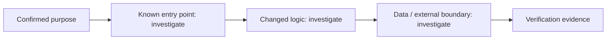

# Change Story — 005-code-workspace-shell

## Confirmed purpose
005-code-workspace-shell: seamless Chat/Code switch, dedicated workspace view with terminal/files/git panels outside the computer screen, omp bootstrapped in the PTY; slice 7 of specs/004-code-mode (R12/R13). Atlas graph: project-atlas/system-map.mmd unchanged — no new durable subsystems, only RPC surface + web route.

## Route
normal

## Diagram-first path

## What will change

- Not yet verified. Link affected entry points, components, contracts, and data paths after repository investigation.

## What stays protected

- Preserve the Purpose Map non-goals and existing contracts until evidence supports a change.

## Evidence and unknowns

| Claim | Classification | Evidence / next probe |
| --- | --- | --- |
| Change path | unknown | inspect codebase and Atlas cards |
