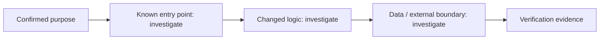

# Change Story — 006-cli-agent-chat

## Confirmed purpose
Adds CLI chat: rakazo chat returns the bot reply as JSON; login/logout/status persist credentials; shared {ok,data|error} envelope and exit codes; npm bin entry. Server unchanged.

## Route
normal

## Diagram-first path

## What will change

- Not yet verified. Link affected entry points, components, contracts, and data paths after repository investigation.

## What stays protected

- Preserve the Purpose Map non-goals and existing contracts until evidence supports a change.

## Evidence and unknowns

| Claim | Classification | Evidence / next probe |
| --- | --- | --- |
| Change path | unknown | inspect codebase and Atlas cards |
