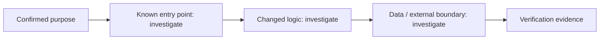

# Change Story — 007-cli-auth-handshake

## Confirmed purpose
Adds browser-approval CLI login: scoped revocable CliToken table, /cli/authorize page, cliTokens list/revoke RPCs, settings panel, and a listener-based rakazo login with headless fallback.

## Route
unclassified

## Diagram-first path

## What will change

- Not yet verified. Link affected entry points, components, contracts, and data paths after repository investigation.

## What stays protected

- Preserve the Purpose Map non-goals and existing contracts until evidence supports a change.

## Evidence and unknowns

| Claim | Classification | Evidence / next probe |
| --- | --- | --- |
| Change path | unknown | inspect codebase and Atlas cards |
